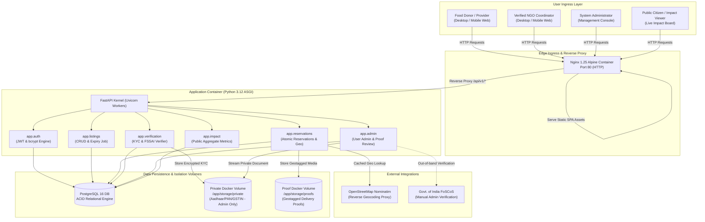
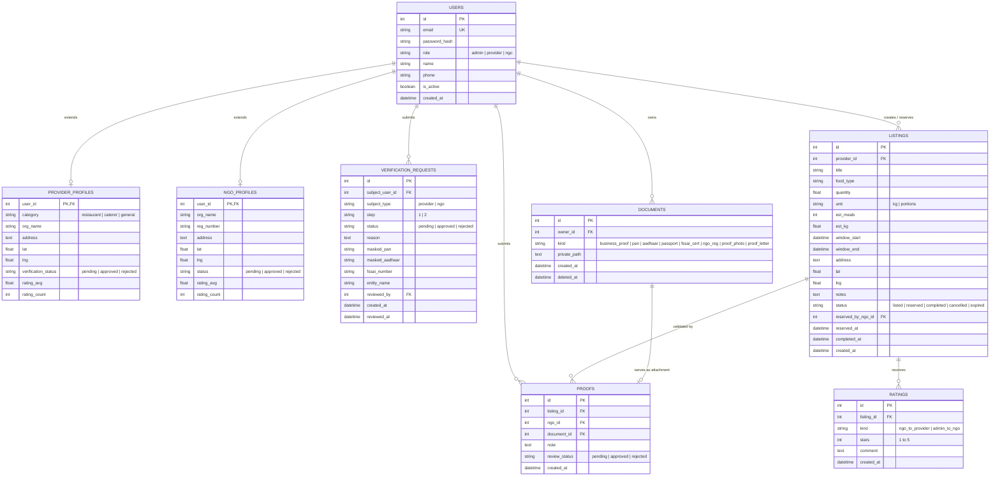
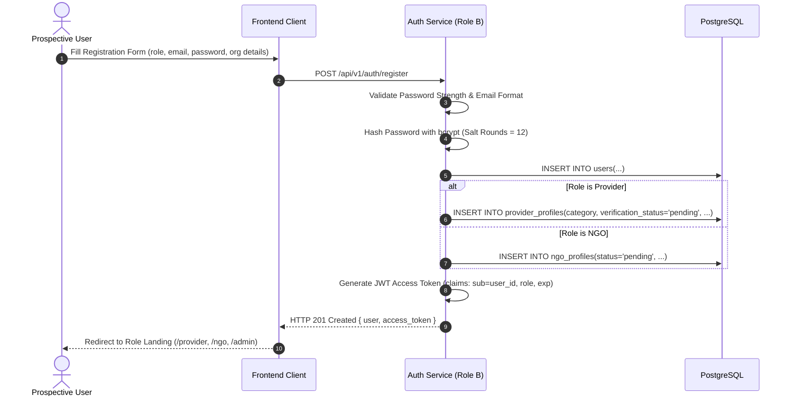
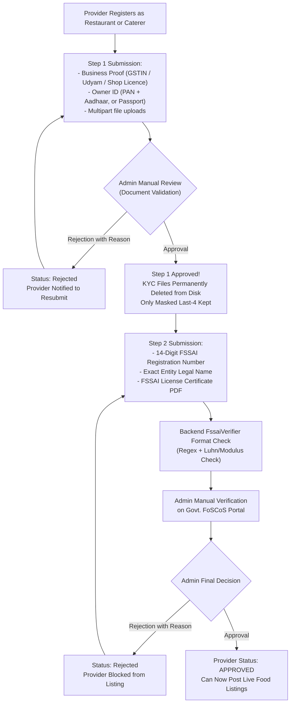
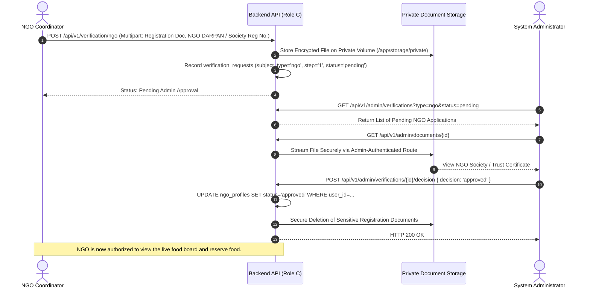
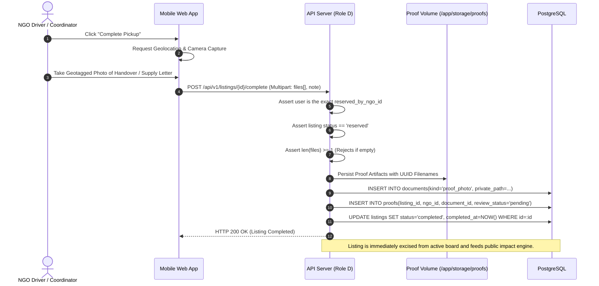
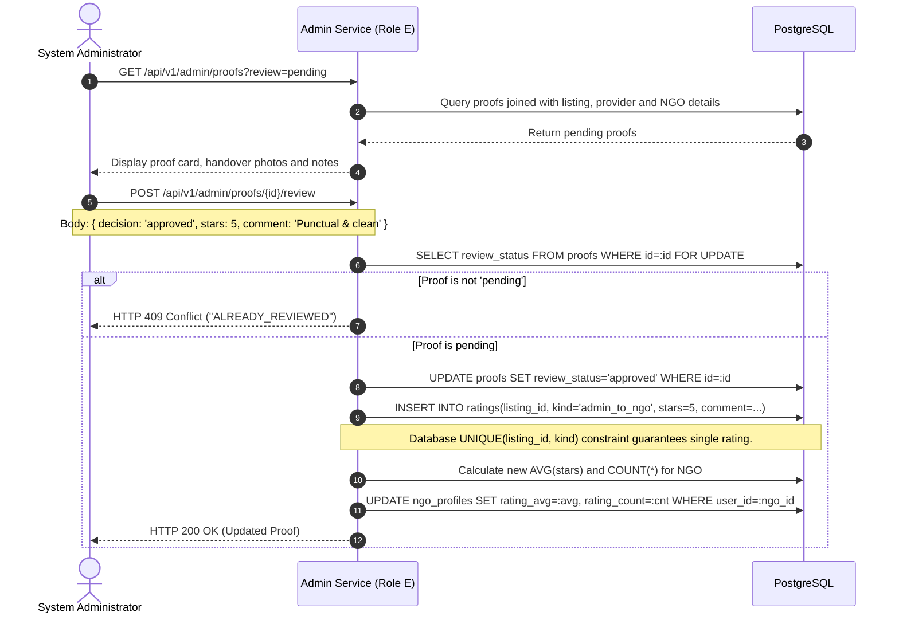
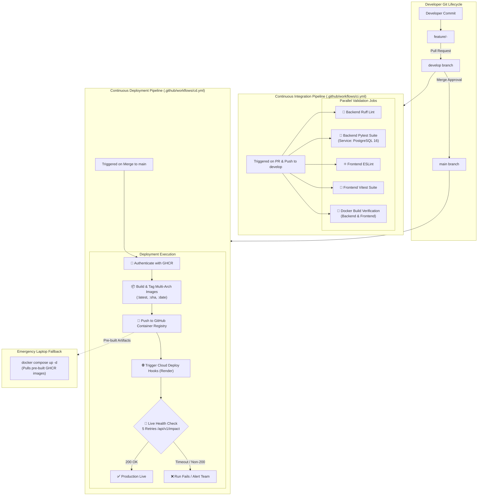

# SharePlate (Agape): Comprehensive Technical Specification & System Dossier

> **Project Name:** SharePlate / Agape  
> **Repository:** `devyanimahalle/Agape`  
> **Final Demonstration:** EXPO · 20 November, 9:00 AM IST  
> **Target Audience:** External Examiners, System Evaluators, Engineering Team  
> **Document Purpose:** Single source of truth detailing problem statement, architectural design, data models, end-to-end workflows, DevOps/CI/CD pipelines, and role distribution.

---

## Table of Contents
1. [Problem Statement & Background](#1-problem-statement--background)
2. [Proposed Solution & Core Philosophy](#2-proposed-solution--core-philosophy)
3. [System Architecture](#3-system-architecture)
4. [Domain Model & Database Schema](#4-domain-model--database-schema)
5. [End-to-End Operational Workflows](#5-end-to-end-operational-workflows)
   - [5.1 Registration & Multi-Role Onboarding](#51-registration--multi-role-onboarding)
   - [5.2 Two-Step Provider Verification Workflow](#52-two-step-provider-verification-workflow)
   - [5.3 NGO Verification Workflow](#53-ngo-verification-workflow)
   - [5.4 Listing Lifecycle & Expiry Automation](#54-listing-lifecycle--expiry-automation)
   - [5.5 Geospatial Discovery & Atomic Reservation](#55-geospatial-discovery--atomic-reservation)
   - [5.6 Pickup Confirmation & Mandatory Proof Upload](#56-pickup-confirmation--mandatory-proof-upload)
   - [5.7 Admin Proof Review & Mutual Rating Mechanics](#57-admin-proof-review--mutual-rating-mechanics)
   - [5.8 Public Impact Aggregation Engine](#58-public-impact-aggregation-engine)
6. [API Specification & Data Contracts](#6-api-specification--data-contracts)
7. [Security, Identity Protection & Privacy Engineering](#7-security-identity-protection--privacy-engineering)
8. [DevOps, Containerization & CI/CD Pipeline](#8-devops-containerization--cicd-pipeline)
9. [Team Structure & Folder Ownership Matrix](#9-team-structure--folder-ownership-matrix)
10. [Live Demo Guide & External Examiner Defense](#10-live-demo-guide--external-examiner-defense)

---

## 1. Problem Statement & Background

### 1.1 The Global and National Food Waste Paradox
Every year, approximately one-third of all food produced globally for human consumption—roughly 1.3 billion tonnes—is lost or wasted. In developing urban economies such as India, this waste occurs simultaneously alongside severe urban food insecurity, hunger, and malnutrition.

Commercial food entities—including restaurants, banquet halls, corporate cafeterias, cloud kitchens, and event caterers—routinely generate substantial quantities of freshly prepared, high-quality surplus food. Currently, this surplus faces systemic disposal barriers:
1. **Unpredictable Timing & Small Windows:** Cooked surplus food has a short consumable lifespan (typically 2 to 6 hours before microbiological degradation).
2. **Lack of Trust and Legal Liability Concerns:** Donors fear legal repercussions or reputational blowback if food quality is contested, leading to disposal rather than donation.
3. **Information Asymmetry:** Commercial food donors do not know which verified non-governmental organizations (NGOs) or community kitchens operate in their immediate micro-radius.
4. **Logistical Overburdening:** Forcing food donors to arrange transport or delivery creates immediate operational friction, guaranteeing that surplus goes directly into urban municipal landfills.

### 1.2 Environmental Consequences
Decomposing food surplus in municipal open dump sites is one of the leading contributors to urban methane emissions (a greenhouse gas with a global warming potential 28 times higher than carbon dioxide) and toxic leachate that contaminates groundwater tables.

---

## 2. Proposed Solution & Core Philosophy

**SharePlate** is a real-time, hyperlocal food surplus redistribution engine built to bridge commercial food donors with rigorously verified NGOs and shelter networks.

```
+-------------------------------------------------------------------------+
|                          SHAREPLATE CORE PRINCIPLES                      |
+-------------------------------------------------------------------------+
| 1. Pure Connection Model : Connects donors and NGOs; NGO manages pickup  |
| 2. Zero-Fraud Verification: Rigorous identity + FSSAI format checks      |
| 3. Atomic Allocation     : Concurrency-safe listing reservation (No 409) |
| 4. Evidentiary Proof     : Geotagged photo/letter required for closure   |
| 5. Mutual Accountability : Bidirectional rating for NGOs & Providers     |
| 6. Public Impact Ledger  : Scientific carbon/meal redistribution stats   |
+-------------------------------------------------------------------------+
```

### 2.1 The "Pure Connector" Architecture
A core engineering decision of SharePlate is that **the platform does not manage transport or collection logistics**.
- **Donors (Providers)** publish surplus availability with exact portion/weight specifications, collection location, and a firm expiration collection window.
- **NGOs** independently handle route planning, vehicle dispatch, collection containers, and physical pickup.
- By eliminating delivery fleet overhead, SharePlate operates as a zero-marginal-cost, ultra-resilient communication layer.

### 2.2 Mathematical Impact Formula
To maintain complete integrity and transparency during public impact reporting, all metrics are derived deterministically from database-verified pickups:

$$\text{Estimated Meals} = \begin{cases} \lfloor \frac{\text{Quantity (kg)}}{0.4} + 0.5 \rfloor & \text{if unit} = \text{kg} \\ \text{Quantity (portions)} & \text{if unit} = \text{portions} \end{cases}$$

$$\text{Estimated kg Saved} = \begin{cases} \text{Quantity (kg)} & \text{if unit} = \text{kg} \\ \text{Quantity (portions)} \times 0.4 & \text{if unit} = \text{portions} \end{cases}$$

Where the standard nutritional constant is fixed at **0.40 kg per meal** ($400\text{ grams}$). All UI representations explicitly label these figures as verified scientific estimates.

---

## 3. System Architecture

SharePlate employs a containerized, three-tier decoupled architecture:
1. **Presentation Tier:** React 18 Single-Page Application (SPA) compiled via Vite, styled with Tailwind CSS, and served through high-performance Nginx reverse proxies with SPA route fallbacks.
2. **Application Tier:** Python 3.12 FastAPI micro-framework utilizing ASGI async request processing, Pydantic v2 schemas for strict serialization, SQLAlchemy 2.0 ORM, and background job scheduling.
3. **Persistence & Storage Tier:** PostgreSQL 16 relational database engine with ACID transactional semantics, alongside private isolated Docker storage volumes for sensitive KYC and proof media.



---

## 4. Domain Model & Database Schema

The database contains 8 core relational tables authored and managed via Alembic migrations.



### Table Definitions & Integrity Constraints

| Table | Primary Key | Foreign Keys | Key Constraints & Indexes |
|---|---|---|---|
| `users` | `id` | None | `email` UNIQUE, Index on `email` and `role` |
| `provider_profiles` | `user_id` | `user_id` $\to$ `users.id` | Verification status defaults to `pending` (except `general`) |
| `ngo_profiles` | `user_id` | `user_id` $\to$ `users.id` | Status defaults to `pending`, geospatial coordinates indexed |
| `verification_requests` | `id` | `subject_user_id` $\to$ `users.id`, `reviewed_by` $\to$ `users.id` | Status indexed for admin review filtering |
| `documents` | `id` | `owner_id` $\to$ `users.id` | Private storage path, soft deletion timestamp `deleted_at` |
| `listings` | `id` | `provider_id` $\to$ `users.id`, `reserved_by_ngo_id` $\to$ `users.id` | Conditional updates for atomic reservation (`status = 'listed'`) |
| `proofs` | `id` | `listing_id` $\to$ `listings.id`, `ngo_id` $\to$ `users.id`, `document_id` $\to$ `documents.id` | Retained indefinitely for compliance auditing |
| `ratings` | `id` | `listing_id` $\to$ `listings.id` | **`UNIQUE(listing_id, kind)`** prevents duplicate ratings |

---

## 5. End-to-End Operational Workflows

### 5.1 Registration & Multi-Role Onboarding
When an actor registers on `/api/v1/auth/register`, they supply identity credentials along with profile parameters tailored to their role.



---

### 5.2 Two-Step Provider Verification Workflow
To safeguard food safety and regulatory compliance, providers categorized as **restaurants** or **caterers** must clear a mandatory **Two-Step Verification** protocol before they are granted permission to create surplus listings.
- **"General" providers** (individuals, small household donors) do not undergo verification and are excluded from the rating system.



---

### 5.3 NGO Verification Workflow
Non-governmental organizations must prove their legitimate legal standing to prevent commercial food diversion.



---

### 5.4 Listing Lifecycle & Expiry Automation
Food listings transition through five mutually exclusive states:
`listed` $\to$ `reserved` $\to$ `completed` | `cancelled` | `expired`.

```mermaid
stateDiagram-v2
    [*] --> listed : Provider creates listing (window_start, window_end in future)
    
    listed --> reserved : Verified NGO claims listing (Atomic conditional update)
    listed --> cancelled : Provider cancels listing before any reservation
    listed --> expired : System background job detects window_end < NOW()
    
    reserved --> completed : NGO confirms pickup with mandatory geotagged proof
    reserved --> listed : NGO cancels reservation (IF window_end > NOW())
    reserved --> expired : NGO cancels reservation (IF window_end <= NOW())
    reserved --> expired : Window passes without proof completion
    
    completed --> [*] : Leaves active board; permanent archive for impact and ratings
    cancelled --> [*] : Archived
    expired --> [*] : Archived
```



---

### 5.5 Geospatial Discovery & Atomic Reservation
When verified NGOs access the food board (`GET /api/v1/board?lat=...&lng=...`), listings are sorted in strict ascending order of physical proximity using the Haversine distance equation:

$$d = 2r \arcsin \left( \sqrt{\sin^2\left(\frac{\Delta \text{lat}}{2}\right) + \cos(\text{lat}_1)\cos(\text{lat}_2)\sin^2\left(\frac{\Delta \text{lng}}{2}\right)} \right)$$

Where $r = 6371\text{ km}$.

#### Atomic Concurrency Control (Race Condition Prevention)
When multiple NGOs attempt to reserve the same listing simultaneously, SharePlate guarantees single-claim integrity using database-level atomic conditional updates:

```sql
-- Executed inside a single transaction
UPDATE listings
SET status = 'reserved',
    reserved_by_ngo_id = :ngo_id,
    reserved_at = NOW()
WHERE id = :listing_id
  AND status = 'listed'
  AND window_end > NOW();
```
- **Winner:** Rows updated = 1 $\to$ Returns HTTP 200 with reservation details.
- **Contender:** Rows updated = 0 $\to$ Throws `HTTP 409 Conflict` with code `"ALREADY_RESERVED"`.

---

### 5.6 Pickup Confirmation & Mandatory Proof Upload
Once reserved, the NGO coordinates vehicle dispatch. Upon arrival, the NGO coordinator must finalize the pickup through the platform.



---

### 5.7 Admin Proof Review & Mutual Rating Mechanics
SharePlate maintains high community accountability through bidirectional feedback:
1. **NGO rates Provider:** Once a pickup completes, the NGO rates the food donor ($1\text{ to }5\text{ stars}$) on hygiene, accurate quantity, and packaging.
2. **Admin rates NGO:** During proof audit, the administrator evaluates the handover photo/letter and assigns $1\text{ to }5\text{ stars}$ rating to the NGO.



---

### 5.8 Public Impact Aggregation Engine
The public impact dashboard (`GET /api/v1/impact`) is an unauthenticated, publicly cacheable endpoint that displays platform-wide redistribution metrics:

```sql
SELECT 
    COALESCE(SUM(est_meals), 0) AS meals_redistributed,
    COALESCE(SUM(est_kg), 0.0)  AS kg_saved,
    COUNT(id)                   AS listings_completed,
    COUNT(DISTINCT reserved_by_ngo_id) AS active_ngos,
    COUNT(DISTINCT provider_id) AS active_providers
FROM listings
WHERE status = 'completed';
```

Monthly trends are derived using temporal grouping (`DATE_TRUNC` / `strftime`):
```sql
SELECT 
    EXTRACT(YEAR FROM completed_at)  AS yr,
    EXTRACT(MONTH FROM completed_at) AS mo,
    SUM(est_meals)                   AS meals,
    SUM(est_kg)                      AS kg
FROM listings
WHERE status = 'completed' AND completed_at IS NOT NULL
GROUP BY yr, mo
ORDER BY yr ASC, mo ASC;
```

---

## 6. API Specification & Data Contracts

All endpoints conform to the `/api/v1` prefix. Payloads and query strings use `snake_case`. Standard authentication utilizes HTTP Header `Authorization: Bearer <JWT>`.

### Error Response Contract
All non-2xx responses strictly comply with the following JSON error envelope:
```json
{
  "detail": "Human-readable explanation of error condition",
  "code": "MACHINE_READABLE_UPPERCASE_CODE"
}
```

### Complete Endpoints Matrix

| Module | Method | Route | Auth / Role | Description |
|---|---|---|---|---|
| **Auth (Role B)** | `POST` | `/auth/register` | Public | Register new user + specific profile |
| | `POST` | `/auth/login` | Public | Authenticate and retrieve Bearer token |
| | `GET` | `/auth/me` | Logged In | Retrieve current user profile & verification |
| **Listings (Role B)**| `POST` | `/listings` | Verified Provider | Create new surplus food listing |
| | `GET` | `/listings/mine` | Provider | List donor's own surplus postings |
| | `PATCH`| `/listings/{id}` | Listing Owner | Edit details while `status = 'listed'` |
| | `POST` | `/listings/{id}/cancel` | Listing Owner | Cancel listing while `status = 'listed'` |
| **Verification (Role C)**| `POST` | `/verification/provider/step1` | Provider | Legal & Identity document submission |
| | `POST` | `/verification/provider/step2` | Provider | 14-digit FSSAI number & cert upload |
| | `GET` | `/verification/provider/status`| Provider | Real-time status of verification steps |
| | `POST` | `/verification/ngo` | NGO | NGO registration & society deed upload |
| | `GET` | `/admin/verifications` | Admin | Review pending verification queue |
| | `POST` | `/admin/verifications/{id}/decision` | Admin | Approve or reject verification request |
| | `GET` | `/admin/documents/{id}` | Admin | Securely stream sensitive KYC document |
| **NGO Board (Role D)** | `GET` | `/geocode?q=` | Logged In | Cached Nominatim geocoding proxy |
| | `GET` | `/board?lat=&lng=` | Verified NGO | Proximity-sorted unexpired food board |
| | `POST` | `/listings/{id}/reserve` | Verified NGO | Concurrency-safe atomic reservation |
| | `POST` | `/listings/{id}/cancel-reservation` | Reserved NGO | Cancel reservation (reverts to board) |
| | `POST` | `/listings/{id}/complete` | Reserved NGO | Complete pickup with mandatory proof |
| | `GET` | `/ngo/reservations` | NGO | View active and historical collections |
| | `POST` | `/listings/{id}/rate-provider` | Reserved NGO | Rate provider (1-5 stars, once only) |
| **Admin & Impact (Role E)**| `GET` | `/admin/stats` | Admin | High-level system counts & breakdown |
| | `GET` | `/admin/users` | Admin | Full user roster with profile attachments |
| | `PATCH`| `/admin/users/{id}` | Admin | Activate or deactivate user access |
| | `GET` | `/admin/proofs?review=` | Admin | List pickup proofs requiring audit |
| | `POST` | `/admin/proofs/{id}/review` | Admin | Approve/reject proof and rate the NGO |
| | `GET` | `/impact` | **Public** | Platform-wide meals, kg, and monthly metrics |

---

## 7. Security, Identity Protection & Privacy Engineering

1. **Stateless JWT Authorization:** Tokens signed using HMAC-SHA256 with configurable expiry (`ACCESS_TOKEN_EXPIRE_MINUTES`).
2. **Password Cryptography:** Secure salting and hashing via `bcrypt` (12 rounds).
3. **KYC Document Isolation:** All identity documents (Aadhaar cards, PAN certificates, GSTIN documents) are written exclusively to a non-public Docker volume (`/app/storage/private`). They cannot be resolved via public URLs or static web routing.
4. **Data Minimization & Masking:** Sensitive national identification numbers are permanently masked upon ingestion:
   - Aadhaar: Stored and displayed exclusively as `XXXXXXXX1234` (last 4 digits).
   - PAN: Stored and displayed as `XXXXX1234X`.
5. **Post-Approval KYC Destruction:** Following an administrator's approval or rejection decision, physical identity document files are unlinked from disk; only the administrative audit log and masked references are retained.
6. **Cross-Origin Resource Sharing (CORS):** Strict domain restriction configurable via `CORS_ORIGINS` environment variable.
7. **Principle of Least Privilege in Containers:** Application containers run as an unprivileged system user (`app:app` with `UID 1000`), blocking container breakout exploits.

---

## 8. DevOps, Containerization & CI/CD Pipeline

The SharePlate infrastructure is engineered for zero-downtime automated deployment, reproducible local development, and an immediate laptop-based demonstration fallback.



### Container Images on GitHub Container Registry (GHCR)
- Backend: `ghcr.io/devyanimahalle/shareplate-backend:latest`
- Frontend: `ghcr.io/devyanimahalle/shareplate-frontend:latest`

### Running the Stack

#### Local Development Mode (Hot Reload)
```bash
docker compose -f docker-compose.dev.yml up --build
```
- Frontend: `http://localhost:3000`
- Backend API: `http://localhost:8000`
- API Interactive Docs: `http://localhost:8000/docs`

#### Production Evaluation Mode (Offline / Laptop Fallback)
```bash
docker compose up -d
```

---

## 9. Team Structure & Folder Ownership Matrix

To eliminate merge collisions, the codebase is partitioned into strict ownership domains:

| Role | Engineer | Module Ownership | Core Responsibilities |
|---|---|---|---|
| **Role A** | Frontend Lead | `frontend/src/design-system/`<br>`frontend/src/pages/public/`<br>`frontend/src/layouts/`<br>`frontend/src/guards/`<br>`frontend/src/api/` | App shell, design tokens, responsive layouts, client routing, public pages, UI kit components. |
| **Role B** | Backend Auth & Listings Lead | `backend/app/auth/`<br>`backend/app/listings/`<br>`frontend/src/features/provider/`<br>`backend/tests/auth/`<br>`backend/tests/listings/` | Registration, login, JWT token issue, provider dashboard, listings CRUD, background expiration scheduler. |
| **Role C** | Data Architecture & Verification Lead | `backend/app/db/` (models & migrations)<br>`backend/app/common/`<br>`backend/app/verification/`<br>`backend/seed/`<br>`frontend/src/features/verification/` | SQLAlchemy models, Alembic migrations, demo database seeding, 2-step KYC/FSSAI verification workflows. |
| **Role D** | NGO & Reservations Lead | `backend/app/reservations/`<br>`frontend/src/features/ngo-reservations/`<br>`backend/tests/reservations/` | Geospatial proximity search, atomic conditional reservation update, pickup proof upload, geocoding cache. |
| **Role E** | Admin, Impact & Release Lead | `backend/app/admin/`<br>`backend/app/impact/`<br>`frontend/src/features/admin-impact/`<br>`backend/tests/admin/`<br>`backend/tests/impact/`<br>`docker/`, `.github/workflows/`, `docs/` | Admin metrics, proof verification screen, user activation, public impact aggregation, Docker, CI/CD, project documentation. |

---

## 10. Live Demo Guide & External Examiner Defense

### 10.1 Pre-Seeded Demonstration Accounts

| Role | Email Address | Password | Profile State & Context |
|---|---|---|---|
| **Admin** | `admin@shareplate.demo` | `Admin@123` | Master administrator account with audit privileges |
| **Restaurant Provider** | `restaurant@shareplate.demo` | `Rest@123` | Fully verified (Steps 1 & 2 approved), established rating (4.5★) |
| **Caterer Provider** | `caterer@shareplate.demo` | `Cater@123` | Step 1 approved, Step 2 FSSAI pending review |
| **General Donor** | `donor@shareplate.demo` | `Donor@123` | Individual household donor (exempt from verification & ratings) |
| **NGO 1 (Hyperlocal)** | `ngo1@shareplate.demo` | `Ngo1@123` | Approved status, located within 2 km of demo restaurant |
| **NGO 2 (Distant)** | `ngo2@shareplate.demo` | `Ngo2@123` | Approved status, located 15 km away (demonstrates distance sort) |
| **NGO 3 (Pending)** | `ngo3@shareplate.demo` | `Ngo3@123` | Unverified registration (blocked from board with 403) |

---

### 10.2 Live Demonstration Script (Step-by-Step for Expo)

```
=============================================================================
                  SHAREPLATE LIVE EXPO DEMONSTRATION FLOW
=============================================================================

1. THE PUBLIC IMPACT BOARD (Role E)
   - Open /impact without logging in.
   - Show live metrics: Meals Redistributed, Kilograms Diverted from Landfills.
   - Point out that all figures are explicitly marked as scientific estimates
     (0.40 kg / meal).

2. PROVIDER SURPLUS POSTING (Role B)
   - Log in as restaurant@shareplate.demo.
   - Navigate to /provider/listings/new.
   - Post surplus: "50 Portions Fresh Dal & Rice", window: Next 3 hours.
   - Confirm backend calculates est_meals=50, est_kg=20.0 kg.

3. UNVERIFIED NGO ACCESS CONTROL (Role C)
   - Log in as ngo3@shareplate.demo (pending status).
   - Attempt to access /ngo food board.
   - Observe HTTP 403 Forbidden ("NOT_VERIFIED") — proof of safety gate.

4. GEOSPATIAL NGO DISCOVERY & ATOMIC CLAIM (Role D)
   - Log in as ngo1@shareplate.demo (approved NGO nearby).
   - Open /ngo board; see listing listed nearest (2.1 km away).
   - Click "Reserve". Listing status immediately shifts to 'reserved'.
   - (Simulate concurrency): If another NGO clicks at same millisecond,
     database conditional update returns HTTP 409 Conflict.

5. PHYSICAL PICKUP & PROOF SUBMISSION (Role D)
   - In NGO dashboard /ngo/reservations, select the active pickup.
   - Click "Complete Pickup"; upload geotagged receipt/delivery photo.
   - Listing transitions to 'completed' and exits live board.
   - NGO rates the Restaurant 5 Stars for packaging.

6. ADMINISTRATIVE PROOF REVIEW & RATING (Role E)
   - Log in as admin@shareplate.demo; go to /admin/proofs.
   - Inspect the uploaded handover proof photo.
   - Click "Approve Proof", rate the NGO 5 Stars with commendation.
   - Observe NGO's rating_avg automatically update via database aggregation.

7. PUBLIC IMPACT UPDATE (Role E)
   - Revisit /impact.
   - The newly completed listing's meals (+50) and kg (+20.0) are now
     reflected in real-time totals and the monthly breakdown bar chart.

8. DEVOPS & LIVE CI/CD PIPELINE (Role E)
   - Open GitHub repository Actions tab.
   - Show passing CI suite (Python 3.12 ruff + pytest + Node 20 vitest).
   - Show CD deployment pipeline and Docker images hosted on GHCR.
=============================================================================
```

---

### 10.3 Key Technical Questions & Examiner Defense

#### Q1: "How do you prevent two NGOs from reserving the exact same listing at the same time?"
> **Answer:** We do not rely on in-memory locks or client-side checks. We use an atomic conditional database update: `UPDATE listings SET status='reserved', reserved_by_ngo_id=:id WHERE id=:id AND status='listed'`. Because PostgreSQL runs under row-level locking during updates, the transaction that commits first claims the row and changes its status. The competing concurrent transaction will find zero rows matching `status='listed'` and the backend immediately returns `HTTP 409 Conflict`.

#### Q2: "Why not verify FSSAI numbers with an automated government API lookup?"
> **Answer:** The Government of India's FoSCoS portal does not provide an open, free, unauthenticated public REST API for real-time license querying. Our architecture implements format and checksum validation on the backend behind a swappable `FssaiVerifier` interface, and routes the document to an administrator dashboard. The administrator cross-verifies the 14-digit number directly on the official FoSCoS portal before authorizing the provider.

#### Q3: "What prevents commercial fraud where restaurants dump rotten food or NGOs resell donated food?"
> **Answer:** 
> 1. Multi-tier onboarding: Providers must submit identity and legal licenses; general providers are separated from commercial ones.
> 2. Proof of Pickup: An NGO cannot close a listing without uploading photographic and document proof of handover.
> 3. Mutual Rating System: NGOs rate the food quality of providers; administrators rate the operational conduct of NGOs. Poor actors are deactivated using `PATCH /api/v1/admin/users/{id}`.

#### Q4: "How does the platform comply with identity privacy laws regarding Aadhaar and PAN storage?"
> **Answer:** National IDs are uploaded directly to a private Docker volume that is never exposed to public routing. We mask all identification numbers upon ingestion (retaining only the last 4 digits). Once an administrator makes an approval or rejection decision, the original KYC document files are permanently unlinked and erased from the filesystem.

---

*Authored by Role E (Admin, Impact & Release) for the SharePlate Engineering Team.*
