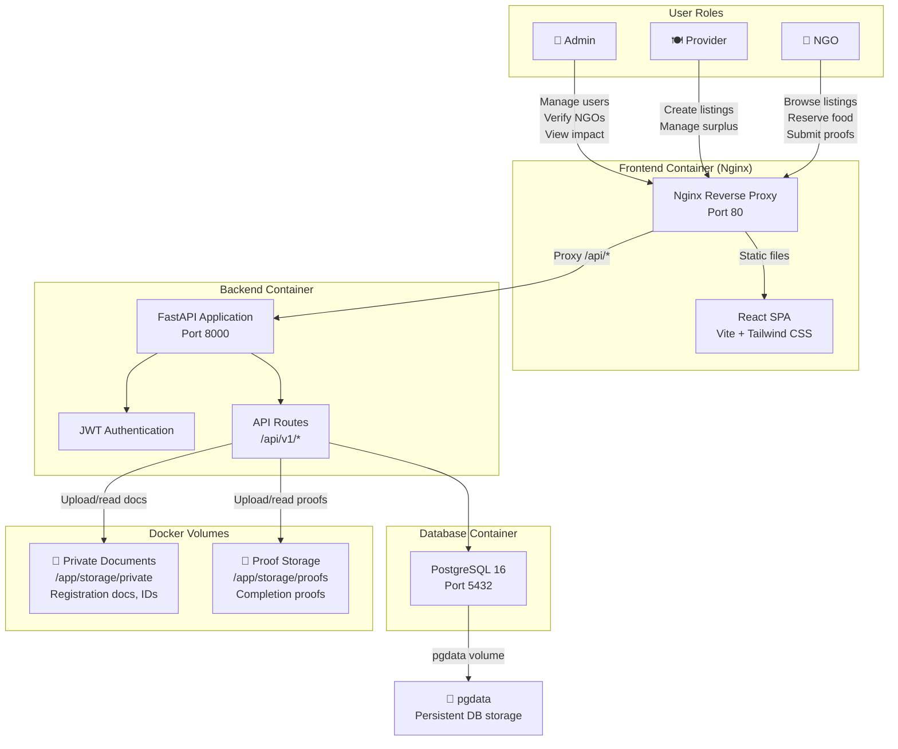
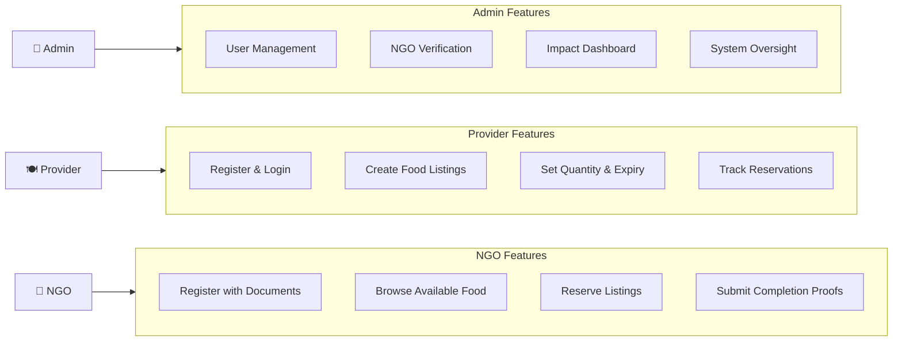
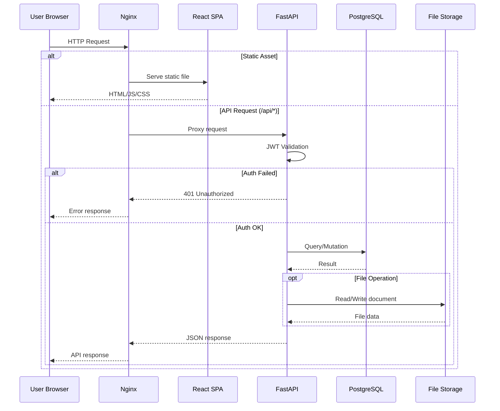
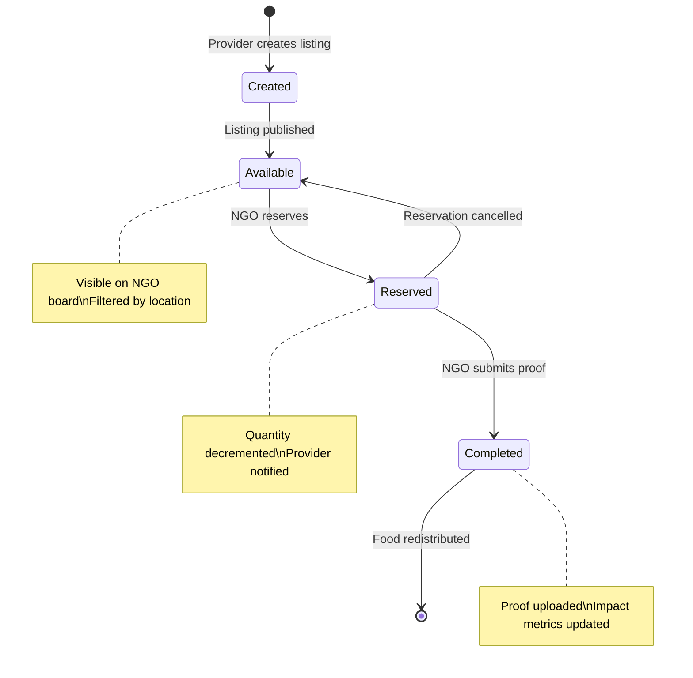
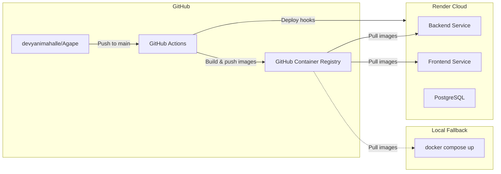

# SharePlate Architecture

## Overview

SharePlate is a food surplus redistribution platform that connects food providers (restaurants, caterers, event organizers) with verified NGOs to minimize food waste and feed communities in need. The platform features role-based access control, document verification workflows, geocoded food listing discovery, and comprehensive impact tracking.

## System Architecture

## User Roles & Features

## Technology Stack

| Layer | Technology | Purpose |
|-------|-----------|---------|
| **Frontend** | React 18 + Vite | Single Page Application |
| **Styling** | Tailwind CSS | Utility-first CSS framework |
| **Routing** | React Router v6 | Client-side routing |
| **Backend** | Python FastAPI | REST API framework |
| **ORM** | SQLAlchemy | Database abstraction |
| **Database** | PostgreSQL 16 | Relational data storage |
| **Auth** | JWT (python-jose) | Stateless authentication |
| **Containerization** | Docker + Compose | Service orchestration |
| **CI/CD** | GitHub Actions | Automated testing & deployment |
| **Registry** | GitHub Container Registry | Docker image hosting |
| **Reverse Proxy** | Nginx | Static serving + API proxy |
| **Deployment** | Render | Cloud hosting platform |

## Data Flow

## Food Listing Lifecycle

## Security Considerations

| Concern | Implementation |
|---------|---------------|
| **Authentication** | JWT tokens with expiration, issued on login |
| **Authorization** | Role-based access control (Admin, Provider, NGO) |
| **Password Storage** | bcrypt hashing via passlib |
| **File Storage** | Private Docker volumes, not publicly accessible |
| **PII Protection** | Masked Aadhaar/PAN display (last 4 digits only) |
| **CORS** | Configurable allowed origins via environment variable |
| **Security Headers** | X-Frame-Options, X-Content-Type-Options, X-XSS-Protection via Nginx |
| **Non-root Container** | Backend runs as unprivileged `app` user |
| **Secrets Management** | Environment variables, never committed to source |

## Deployment Architecture

