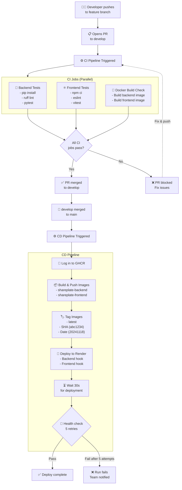
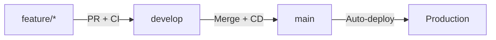

# SharePlate CI/CD Pipeline

## Overview

SharePlate uses a two-stage CI/CD pipeline powered by GitHub Actions. The **CI pipeline** runs automated tests and build checks on every pull request and push to the `develop` branch. The **CD pipeline** builds Docker images, pushes them to GitHub Container Registry (GHCR), and deploys to Render on every push to the `main` branch.

## Pipeline Diagram



## Pipeline Stages

### CI Pipeline (`.github/workflows/ci.yml`)

Triggered on: **Pull requests to `develop`** and **pushes to `develop`**

| Stage | Description | Tools |
|-------|-------------|-------|
| **Backend Tests** | Installs Python dependencies, runs ruff linter, executes pytest suite against a PostgreSQL 16 service container | Python 3.12, ruff, pytest |
| **Frontend Tests** | Installs Node.js dependencies, runs ESLint, executes Vitest test suite | Node.js 20, ESLint, Vitest |
| **Docker Build Check** | Builds both backend and frontend Docker images to verify Dockerfiles are valid | Docker |

> All three jobs run **in parallel** for faster feedback.

### CD Pipeline (`.github/workflows/cd.yml`)

Triggered on: **Pushes to `main`**

| Stage | Description |
|-------|-------------|
| **GHCR Login** | Authenticates with GitHub Container Registry using `GITHUB_TOKEN` |
| **Build & Push** | Builds Docker images for backend and frontend, pushes to GHCR |
| **Tagging** | Each image gets 3 tags: `latest`, short SHA (e.g., `abc1234`), and date (e.g., `20241118`) |
| **Deploy** | Triggers Render deploy hooks via HTTP requests |
| **Wait** | Pauses 30 seconds for Render to pull and start new images |
| **Health Check** | Hits `/api/v1/impact` endpoint up to 5 times with 10s intervals. **Fails the run** if the app doesn't respond |

## Required Repository Secrets

Configure these in **GitHub → Settings → Secrets and variables → Actions**:

| Secret | Required | Description |
|--------|----------|-------------|
| `RENDER_BACKEND_HOOK` | Optional | Render deploy hook URL for the backend service |
| `RENDER_FRONTEND_HOOK` | Optional | Render deploy hook URL for the frontend service |
| `DEPLOY_URL` | Optional | Base URL of the deployed app (e.g., `https://shareplate.onrender.com`) |

> **Note:** `GITHUB_TOKEN` is automatically provided by GitHub Actions and does not need to be configured manually. It has the `packages: write` permission to push to GHCR.

## Branch Strategy



| Branch | Purpose | Protection |
|--------|---------|------------|
| `feature/*` | Individual feature work | None |
| `develop` | Integration branch, CI runs here | Require PR, require CI pass |
| `main` | Production-ready code, CD runs here | Require PR from develop |

## Image Registry

All images are stored in GitHub Container Registry (GHCR):

| Image | URL |
|-------|-----|
| Backend | `ghcr.io/devyanimahalle/shareplate-backend` |
| Frontend | `ghcr.io/devyanimahalle/shareplate-frontend` |

Each push to `main` creates images with three tags:
- `latest` — always points to the most recent build
- `<sha>` — Git short SHA for exact commit traceability (e.g., `abc1234`)
- `<date>` — Build date for quick chronological reference (e.g., `20241118`)

## Fallback: Local Deployment

If Render is unavailable or for local testing with production images:

```bash
# Pull and run the latest GHCR images locally
docker compose up -d

# Or build from source for development
docker compose -f docker-compose.dev.yml up --build
```

This uses the `docker-compose.yml` at the repo root, which pulls pre-built images from GHCR and runs the full stack (PostgreSQL + Backend + Frontend) on your laptop.

## Rollback Procedure

To roll back to a previous version:

```bash
# 1. Find the SHA or date tag of the last known good build
# 2. Set the TAG environment variable
export TAG=abc1234

# 3. Pull and restart with the specific version
docker compose up -d
```

Or re-deploy on Render by selecting the previous commit in the Render dashboard.
